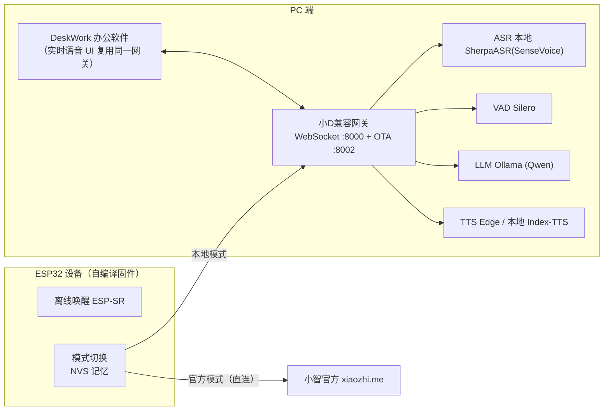

# 小D语音 · xiaod-voice 项目规划

> 本地优先实时语音 + ESP32 双模式（本地小D / 小智官方）
> 版本：v0.1（规划稿）  日期：2026-10-13
> 关联项目：DeskWork（`D:\projects\localdesk-agent`）

---

## 1. 背景与目标

### 1.1 背景
DeskWork 现有语音为**轮次模式**（点一下→录一段→整句识别→整句回复→整段朗读），存在识别慢、丢前两字、打断缺失、唤醒迟钝/闪退等问题。用户要的是"**反应快、语言自然、能随时打断、语音唤醒**"的实时语音体验，并希望一块自购的 **ESP32 开发板**能在两种后端间切换：

- **本地模式**：走电脑端本地模型（Ollama + 本地 ASR/TTS），隐私、免费、可离线；
- **官方模式**：走小智官方通道（xiaozhi.me），获得官方级自然度与全双工体验。

### 1.2 目标
1. 做一个 PC 端"**小D兼容网关**"（小智设备协议）：同时服务 DeskWork 软件的实时语音和 ESP32 设备的本地模式。
2. 自研/改造 **ESP32 固件**（fork xiaozhi-esp32，自行编译）：内置本地/官方双模式，可一键切换、掉电记忆。
3. 体验目标：本地模式全链路响应 ~1 秒级、可打断、语音自然；官方模式直连官方。

---

## 2. 总体架构



**核心原则**：
- 切换点在**固件**（服务器地址切换），官方通道**直连**，不经 PC 转发（避免 TLS/激活码代理、PC 关机仍可用官方）。
- 网关只处理本地模式，且**一套网关两端复用**（DeskWork 软件 + ESP32 硬件）。
- 协议层完全复用小智开放协议（`/xiaozhi/v1/` WebSocket + OTA + MCP），保证生态互通。

---

## 3. 双模式设计（固件）

| 模式 | 连接目标 | 依赖 | 特点 |
|---|---|---|---|
| 官方模式 | 官方 OTA/WS（默认流程） | 互联网 + 设备激活码 | 官方级自然度/全双工，PC 关机可用 |
| 本地模式 | `ws://电脑IP:8000/xiaozhi/v1/`（IP/端口在配网页可填） | 局域网内 PC 开机并运行网关 | 隐私、免费、可离线 |

- 模式标志 `local / cloud` 存 **NVS**，开机保持上次选择。
- 切换触发（双保险）：
  1. 配网页面下拉（配置一次，最稳）；
  2. 双击设备 BOOT 键快捷切换；
  3. 切换后设备语音播报"已切换到本地/官方模式"。
- 语音命令切换（如"用本地模型"）在本地模式由网关实现；官方模式不保证，故切回本地仍靠按键。

---

## 4. 技术选型

### 4.1 本地模式模型（全部可本地）
| 环节 | 选型 | 说明 |
|---|---|---|
| LLM | **Ollama**：`qwen3.5:9b-q4km`（主力），按需 coder/reasoning | 已安装，Ollama 需监听局域网 `0.0.0.0:11434` |
| ASR | **SherpaASR + SenseVoice**（本地，复用已有模型） | `D:\models\sherpa-onnx-sense-voice-zh-en-ja-ko-yue-int8-2025-09-09` |
| VAD | **SileroVAD**（本地、免费） | 说话起止检测、打断 |
| TTS | 验证期 **EdgeTTS**（免费）；正式期可选 **Index-TTS**（本地，更自然） | 本地流式 TTS 是后续优化重点 |
| 声纹 | 3D-Speaker（可选，本地） | 后期 |
| 记忆 | mem_local_short（本地短期记忆） | 免费 |
| 意图 | function_call（模型函数调用） | 速度快、效果好 |
| 视觉 | 可选 `qwen2.5vl:7b` 或智谱免费 glm-4v-flash | 拍照识别 |

### 4.2 工具链
- **固件**：ESP-IDF **v6.1**（项目要求 ≥ v6.0.1，不支持 5.x）；离线唤醒 ESP-SR；音频 Opus。
- **网关/服务端**：Python（本地源码部署，不强制 Docker）。
- **版本控制**：git；源码备份私库 + OneDrive。

### 4.3 关于"开源服务端 vs 自研"
- 采用"**先借后自研**"：
  - M1 直接部署开源 `xinnan-tech/xiaozhi-esp32-server`（最简化、本地源码、无数据库），快速跑通并摸清协议；
  - M2 自研轻量网关（参考其架构，不 fork、不深度耦合），便于集成进 DeskWork 与双击即用。

---

## 5. 项目目录结构

```
D:\projects\xiaod-voice\
├─ docs\            # 规划、协议笔记、测试记录
├─ gateway\         # 自研小D兼容网关（Python，M2）
├─ firmware\        # ESP32 固件 fork（M4，含双模式改动）
├─ reference\       # 开源 xiaozhi-server 验证副本（M1，不进成品）
├─ scripts\         # 部署/启动/打包/备份脚本
└─ tests\           # 验证脚本（含延迟测试、音频回路测试）
```

---

## 6. 里程碑与分步计划

| 里程碑 | 内容 | 验收 |
|---|---|---|
| **M1 开源服务端验证** | 本地源码部署最简化 xiaozhi-server；配置 Ollama + SherpaASR + Silero + EdgeTTS；官方固件先跑通"本地/官方"两通道 | ESP32 能分别对话；记录各环节延迟 |
| **M2 自研轻量网关** | 实现小智兼容 OTA + WebSocket、Opus 收发、握手、ASR→LLM→TTS 编排、打断；可独立常驻 | 官方/自编译固件本地模式可连，响应 ~1s |
| **M3 DeskWork 实时语音集成** | DeskWork 内实时语音 UI、常驻/托盘、流式 ASR、本地+在线模式切换 | 软件内语音体验达标 |
| **M4 ESP32 固件双模式** | fork xiaozhi-esp32；NVS 模式记忆；配网页+按键切换；语音播报 | 一键切换、掉电记忆、两通道均通 |
| **M5 联调/打包/备份/沉淀** | 全链路测试、问题修复、打包、源码备份、经验沉淀 | 功能清单全部通过、无崩溃 |

---

## 7. 环境与依赖（待 M1 落实）

- [ ] 确认 ESP32 **具体板型**（决定 board 目录、屏幕、麦克风、是否支持 AEC 全双工）。
- [ ] Python 版本：开源 server 多依赖 3.10–3.12；系统 Python 为 **3.14（可能依赖不兼容）**，拟为 M1 建专用 venv（3.11/3.12）。
- [ ] Ollama 监听局域网：设置 `OLLAMA_HOST=0.0.0.0:11434`。
- [ ] 防火墙放行 8000/8002/11434。
- [ ] 官方模式：在 xiaozhi.me 后台生成/绑定设备激活码。
- [ ] 固件阶段安装 ESP-IDF v6.1 工具链。

---

## 8. 风险与应对

| 风险 | 影响 | 应对 |
|---|---|---|
| Python 3.14 与开源 server 依赖不兼容 | M1 受阻 | 专用 venv（3.11/3.12） |
| 本地 8GB 跑 9B + ASR/TTS 显存紧张 | 卡顿/延迟 | 模型按需加载、ASR 走 CPU int8、TTS 先 edge |
| 本地 TTS 自然度/延迟不足 | 不够自然 | 先 EdgeTTS 兜底，验证 Index-TTS |
| 真全双工 8GB 吃力 | 体验受限 | 本地做"半双工+流式+可打断"，全双工走官方 |
| 局域网 IP 变化 | 设备连不上 | 配网页可填 + 网关支持固定/提示 |

---

## 9. 待确认事项
1. ESP32 具体板型/型号（是否带屏幕、麦克风、AEC）。
2. 本地模式 TTS 是否接受 EdgeTTS（联网）起步，还是要求纯离线起步。
3. 网关常驻形态：随 DeskWork 托盘常驻，还是独立常驻进程。
